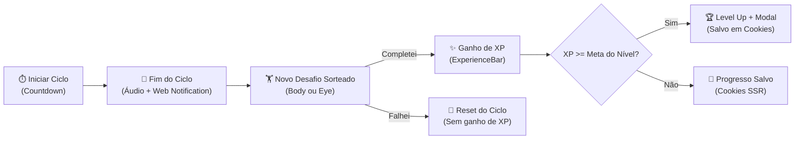
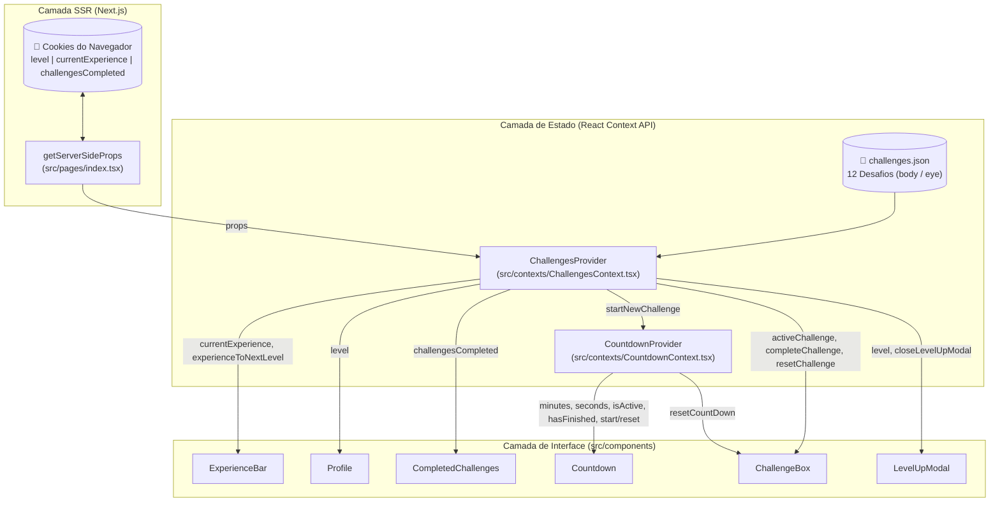

# 🏃‍♂️ move.it — Estudo de Caso & Documentação Técnica (`moveit-next`)

> **Resumo Executivo:** O **move.it** é uma aplicação web interativa construída com **Next.js, React e TypeScript** que une a técnica **Pomodoro** a mecânicas de **gamificação de RPG** (pontos de experiência, progressão exponencial de nível e desafios físicos/visuais). Seu objetivo é combater o sedentarismo e a fadiga ocular de desenvolvedores e profissionais que passam longos períodos em frente ao computador.

---

## 📌 Sumário

1. [Visão Geral e Problema de Negócio](#-1-visão-geral-e-problema-de-negócio)
2. [A Solução: Ciclo de Engajamento e Saúde](#-2-a-solução-ciclo-de-engajamento-e-saúde)
3. [Casos de Uso (Use Cases)](#-3-casos-de-uso-use-cases)
4. [Regras de Negócio e Motor de Gamificação](#-4-regras-de-negócio-e-motor-de-gamificação)
5. [Arquitetura e Fluxo de Dados](#-5-arquitetura-e-fluxo-de-dados)
6. [Catálogo de Componentes e Responsabilidades](#-6-catálogo-de-componentes-e-responsabilidades)
7. [Design System, Tipografia e Responsividade](#-7-design-system-tipografia-e-responsividade)
8. [Decisões Técnicas (ADRs)](#-8-decisões-técnicas-adrs)
9. [Como Executar o Projeto](#-9-como-executar-o-projeto)

---

## 🎯 1. Visão Geral e Problema de Negócio

### O Problema
Profissionais de tecnologia e trabalhadores remotos frequentemente permanecem horas seguidas em foco contínuo diante das telas sem realizar pausas ergonômicas. Isso acarreta:
- **Fadiga visual (Síndrome da Visão de Computador):** ressecamento ocular e perda de foco à distância.
- **Tensão musculoesquelética:** dores cervicais, lombares e nos punhos/antebraços por falta de alongamento.
- **Baixa adesão a timers tradicionais:** cronômetros Pomodoro convencionais avisam quando o tempo acaba, mas não oferecem **O QUE fazer** na pausa nem geram **recompensa imediata** pelo cuidado com a saúde.

### A Proposta de Valor do `move.it`
Transformar cada bloco de foco concluído em um **gatilho de recompensa**: ao zerar o cronômetro, o usuário desbloqueia um exercício curto e guiado (para o corpo ou para os olhos) extraído de [`challenges.json`](file:///Volumes/crucial-x9/ideias/moveit-next/challenges.json). Ao completá-lo, acumula **XP (Pontos de Experiência)**, preenche sua barra de progresso ([`ExperienceBar`](file:///Volumes/crucial-x9/ideias/moveit-next/src/components/ExperienceBar/index.tsx)) e sobe de nível ([`LevelUpModal`](file:///Volumes/crucial-x9/ideias/moveit-next/src/components/LevelUpModal/index.tsx)).

---

## 💡 2. A Solução: Ciclo de Engajamento e Saúde

O fluxo central do produto opera como um *loop* de hábito (Gatilho → Ação → Recompensa → Investimento):



---

## 📋 3. Casos de Uso (Use Cases)

### Matriz de Casos de Uso Extraídos do Código

| ID | Caso de Uso | Ator | Módulo / Arquivo Principal |
| :--- | :--- | :--- | :--- |
| **UC01** | Hidratar sessão do usuário via Server-Side Rendering (SSR) | Sistema (Next.js) | [`src/pages/index.tsx`](file:///Volumes/crucial-x9/ideias/moveit-next/src/pages/index.tsx#L52-L62) |
| **UC02** | Iniciar e monitorar um ciclo de foco no cronômetro | Usuário | [`src/contexts/CountdownContext.tsx`](file:///Volumes/crucial-x9/ideias/moveit-next/src/contexts/CountdownContext.tsx#L32-L53) |
| **UC03** | Abandonar um ciclo em andamento | Usuário | [`src/components/Countdown/index.tsx`](file:///Volumes/crucial-x9/ideias/moveit-next/src/components/Countdown/index.tsx#L43-L49) |
| **UC04** | Sortear desafio ergonômico e disparar alerta multimodal | Sistema | [`src/contexts/ChallengesContext.tsx`](file:///Volumes/crucial-x9/ideias/moveit-next/src/contexts/ChallengesContext.tsx#L70-L83) |
| **UC05** | Concluir desafio, contabilizar XP e calcular *carry-over* | Usuário | [`src/contexts/ChallengesContext.tsx`](file:///Volumes/crucial-x9/ideias/moveit-next/src/contexts/ChallengesContext.tsx#L89-L106) |
| **UC06** | Falhar/Recusar desafio e reiniciar o cronômetro | Usuário | [`src/components/ChallangeBox/index.tsx`](file:///Volumes/crucial-x9/ideias/moveit-next/src/components/ChallangeBox/index.tsx#L14-L17) |
| **UC07** | Subir de nível e exibir modal comemorativo | Sistema / Usuário | [`src/components/LevelUpModal/index.tsx`](file:///Volumes/crucial-x9/ideias/moveit-next/src/components/LevelUpModal/index.tsx) |

---

### Detalhamento dos Fluxos de Uso

#### **UC01 — Hidratar Sessão do Usuário via SSR (`getServerSideProps`)**
- **Pré-condição:** Usuário acessa a rota `/` no navegador.
- **Fluxo Principal:**
  1. Antes de enviar a interface ao cliente, o servidor Next.js intercepta a requisição em [`getServerSideProps`](file:///Volumes/crucial-x9/ideias/moveit-next/src/pages/index.tsx#L52-L62) e lê `ctx.req.cookies`.
  2. Os valores `level`, `currentExperience` e `challengesCompleted` são convertidos para `Number` e repassados como `props` para o componente [`Home`](file:///Volumes/crucial-x9/ideias/moveit-next/src/pages/index.tsx#L20-L50).
  3. O [`ChallengesProvider`](file:///Volumes/crucial-x9/ideias/moveit-next/src/contexts/ChallengesContext.tsx#L34-L40) inicializa os estados usando coalescência nula (`rest.level ?? 1`, `rest.currentExperience ?? 0`, `rest.challengesCompleted ?? 0`).
- **Pós-condição:** A página já é renderizada no primeiro pacote HTML com o nível, barra de XP e total de desafios exatos do usuário.

#### **UC02 & UC03 — Iniciar ou Abandonar Ciclo de Foco**
- **Fluxo Principal (Iniciar):**
  1. Usuário clica em **"Iniciar um ciclo"** no [`Countdown`](file:///Volumes/crucial-x9/ideias/moveit-next/src/components/Countdown/index.tsx#L50-L55).
  2. `startCountDown()` altera `isActive` para `true`.
  3. Um `useEffect` em [`CountdownContext.tsx`](file:///Volumes/crucial-x9/ideias/moveit-next/src/contexts/CountdownContext.tsx#L43-L53) agenda um `setTimeout` de `1000ms` (1 segundo), decrementando `time` continuamente até chegar a `0`.
- **Fluxo Alternativo (Abandonar):**
  1. Enquanto `isActive` é `true`, o botão assume o estado visual ativo (`Abandonar ciclo`, com hover em vermelho `--red`).
  2. Se o usuário clicar, `resetCountDown()` executa `clearTimeout(countdownTimout)` imediatamente, restaura `isActive = false`, `hasFinished = false` e reinicia o tempo sem liberar nenhum desafio.

#### **UC04 — Sorteio de Desafio e Notificação Multimodal**
- **Gatilho:** `isActive === true` e `time === 0` no [`CountdownContext`](file:///Volumes/crucial-x9/ideias/moveit-next/src/contexts/CountdownContext.tsx#L48-L52).
- **Fluxo Principal:**
  1. O cronômetro marca `hasFinished = true` (exibindo o botão desabilitado `"Ciclo encerrado"` com borda inferior verde e ícone `check_circle.svg`).
  2. `startNewChallenge()` é invocado em [`ChallengesContext.tsx`](file:///Volumes/crucial-x9/ideias/moveit-next/src/contexts/ChallengesContext.tsx#L70-L83).
  3. Um desafio aleatório é sorteado de [`challenges.json`](file:///Volumes/crucial-x9/ideias/moveit-next/challenges.json) via `Math.floor(Math.random() * challenges.length)`.
  4. O sistema toca o alerta sonoro `new Audio('/notification.mp3').play()`.
  5. Caso `Notification.permission === 'granted'`, dispara uma notificação nativa do sistema operacional: `"Novo desafio 🎉 — Valendo X xp!"`.

#### **UC05 & UC06 — Resolução do Desafio (`Completei` vs. `Falhei`)**
- **Fluxo `Completei` (`handleChallengeSucceeded`):**
  1. Em [`ChallengeBox`](file:///Volumes/crucial-x9/ideias/moveit-next/src/components/ChallangeBox/index.tsx#L9-L12), o usuário clica no botão verde **Completei**.
  2. `completeChallenge()` soma o `amount` do desafio ao `currentExperience`.
  3. Se o novo XP atingir ou ultrapassar `experienceToNextLevel`, o excedente (*carry-over*) é calculado (`finalExperience = finalExperience - experienceToNextLevel`) e `levelUp()` é chamado.
  4. O desafio ativo é limpo (`setActiveChallenge(null)`), `challengesCompleted` é incrementado em `+1` e o cronômetro é resetado (`resetCountDown()`).
- **Fluxo `Falhei` (`handleChallengeFailed`):**
  1. O usuário clica no botão vermelho **Falhei**.
  2. `resetChallenge()` limpa o desafio ativo sem alterar XP ou contador de desafios completos, e `resetCountDown()` libera o cronômetro para uma nova tentativa.

---

## 🧮 4. Regras de Negócio e Motor de Gamificação

### 4.1. Fórmula de Progressão de Nível (Curva de RPG)
Em [`ChallengesContext.tsx`](file:///Volumes/crucial-x9/ideias/moveit-next/src/contexts/ChallengesContext.tsx#L45), a quantidade de experiência necessária para alcançar o próximo nível segue uma progressão quadrática baseada em múltiplos de 4:

$$
\text{XP}_{\text{próximo nível}} = \left((\text{level} + 1) \times 4\right)^2
$$

| Nível Atual (`level`) | Cálculo | XP Necessário (`experienceToNextLevel`) |
| :---: | :---: | :---: |
| **Level 1** | $((1 + 1) \times 4)^2 = 8^2$ | **64 xp** |
| **Level 2** | $((2 + 1) \times 4)^2 = 12^2$ | **144 xp** |
| **Level 3** | $((3 + 1) \times 4)^2 = 16^2$ | **256 xp** |
| **Level 4** | $((4 + 1) \times 4)^2 = 20^2$ | **400 xp** |
| **Level 5** | $((5 + 1) \times 4)^2 = 24^2$ | **576 xp** |

### 4.2. Cálculo Percentual da Barra de Experiência
No componente [`ExperienceBar`](file:///Volumes/crucial-x9/ideias/moveit-next/src/components/ExperienceBar/index.tsx#L8), a largura preenchida da barra verde e o deslocamento horizontal (`left`) do rótulo flutuante são calculados dinamicamente:

$$
\text{Percentual (\%)} = \frac{\text{round}(\text{currentExperience} \times 100)}{\text{experienceToNextLevel}}
$$

### 4.3. Base de Desafios ([`challenges.json`](file:///Volumes/crucial-x9/ideias/moveit-next/challenges.json))
O catálogo possui **12 desafios ergonômicos** divididos em duas categorias:
- **`body` (9 exercícios corporais):** alongamentos de punhos, braços, pescoço, região cervical, posterior de coxa, lombar e rotação de cintura. Recompensas variam de **50 xp a 100 xp**.
- **`eye` (3 exercícios visuais):** *palming* (descanso ocular no escuro por 2 minutos), foco panorâmico em 4 direções ao longe e massagem circular abaixo das sobrancelhas. Recompensas variam de **70 xp a 140 xp**.

---

## 🏗️ 5. Arquitetura e Fluxo de Dados

### Diagrama de Relacionamento entre Contextos e Componentes



---

## 🧩 6. Catálogo de Componentes e Responsabilidades

- **[`ExperienceBar`](file:///Volumes/crucial-x9/ideias/moveit-next/src/components/ExperienceBar/index.tsx)** ([`ExperienceBar.module.css`](file:///Volumes/crucial-x9/ideias/moveit-next/src/styles/components/ExperienceBar.module.css)): Cabeçalho da aplicação que exibe o intervalo `0 xp` até `experienceToNextLevel xp`, renderizando a barra de progresso verde e o marcador flutuante na posição exata do XP atual.
- **[`Profile`](file:///Volumes/crucial-x9/ideias/moveit-next/src/components/Profile/index.tsx)** ([`Profile.module.css`](file:///Volumes/crucial-x9/ideias/moveit-next/src/styles/components/Profile.module.css)): Exibe o avatar do GitHub (`https://github.com/eleazar-nascimento.png`), nome do usuário e o `level` atual acompanhado do ícone `icons/level.svg`.
- **[`CompletedChallenges`](file:///Volumes/crucial-x9/ideias/moveit-next/src/components/CompletedChallenges/index.tsx)** ([`CompletedChallenges.module.css`](file:///Volumes/crucial-x9/ideias/moveit-next/src/styles/components/CompletedChallenges.module.css)): Indicador numérico de quantos desafios foram superados ao longo da jornada.
- **[`Countdown`](file:///Volumes/crucial-x9/ideias/moveit-next/src/components/Countdown/index.tsx)** ([`Countdown.module.css`](file:///Volumes/crucial-x9/ideias/moveit-next/src/styles/components/Countdown.module.css)): Formata `minutes` e `seconds` com `padStart(2, '0').split('')` para renderizar cada dígito individualmente com a fonte `Rajdhani`, controlando os três estados do botão de ação (*Iniciar um ciclo*, *Abandonar ciclo* e *Ciclo encerrado*).
- **[`ChallengeBox`](file:///Volumes/crucial-x9/ideias/moveit-next/src/components/ChallangeBox/index.tsx)** ([`ChallengeBox.module.css`](file:///Volumes/crucial-x9/ideias/moveit-next/src/styles/components/ChallengeBox.module.css)): Card lateral direito que alterna entre o estado de espera (`Finalize um ciclo para receber um desafio`) e o estado ativo com o ícone (`body.svg` ou `eye.svg`), descrição do alongamento, valor em XP e botões **Falhei** / **Completei**.
- **[`LevelUpModal`](file:///Volumes/crucial-x9/ideias/moveit-next/src/components/LevelUpModal/index.tsx)** ([`LevelUpModal.module.css`](file:///Volumes/crucial-x9/ideias/moveit-next/src/styles/components/LevelUpModal.module.css)): Modal com *overlay* translúcido renderizado condicionalmente pelo próprio [`ChallengesProvider`](file:///Volumes/crucial-x9/ideias/moveit-next/src/contexts/ChallengesContext.tsx#L124) quando `isLevelUpModalOpen === true`.

---

## 🎨 7. Design System, Tipografia e Responsividade

Definido globalmente em [`src/styles/global.css`](file:///Volumes/crucial-x9/ideias/moveit-next/src/styles/global.css) e [`src/pages/_document.tsx`](file:///Volumes/crucial-x9/ideias/moveit-next/src/pages/_document.tsx):

### Paleta de Cores (CSS Custom Properties)
| Variável CSS | Hexadecimal | Uso Semântico na Interface |
| :--- | :--- | :--- |
| `--background` | `#F2F3F5` | Fundo principal da aplicação |
| `--white` | `#FFFFFF` | Superfície dos cards (`Countdown`, `ChallengeBox`, `LevelUpModal`) |
| `--title` | `#2E3F5B` | Títulos, dígitos do cronômetro e destaques fortes |
| `--text` | `#666666` | Textos corridos, descrições de desafios e rótulos |
| `--blue` / `--blue-dark` | `#5965E0` / `#4953B8` | Ação primária (*Iniciar um ciclo*), cabeçalho de XP do desafio |
| `--green` | `#4CD62B` | Barra de progresso de XP, borda de ciclo encerrado e botão *Completei* |
| `--red` | `#E83F5B` | Hover de *Abandonar ciclo* e botão *Falhei* |

### Tipografia e Escala Fluida (`rem`)
- **Inter (`400`, `500`, `600`):** Tipografia principal de interface para máxima legibilidade.
- **Rajdhani (`600`):** Tipografia display geométrica dedicada aos dígitos do cronômetro (`8.5rem`).
- **Adaptação de Viewport:** A aplicação utiliza `rem` em todos os espaçamentos e fontes, reduzindo proporcionalmente a base do `html` em telas menores ([`global.css`](file:///Volumes/crucial-x9/ideias/moveit-next/src/styles/global.css#L21-L31)):
  - Desktop (`> 1080px`): `100%` (`16px`)
  - Tablet / Laptop menor (`<= 1080px`): `93.75%` (`15px`)
  - Mobile (`<= 720px`): `87.5%` (`14px`)

---

## 🛠️ 8. Decisões Técnicas (ADRs)

### ADR 01: Persistência em Cookies (`js-cookie`) + Next.js SSR
- **Problema:** Se os dados de nível e XP fossem salvos em `localStorage`, o servidor Next.js não teria acesso a eles durante a renderização inicial, causando *flash* de conteúdo desatualizado (Nível 1 / 0 XP) até o JavaScript rodar no cliente.
- **Decisão:** Armazenar `level`, `currentExperience` e `challengesCompleted` em Cookies HTTP via `js-cookie` ([`ChallengesContext.tsx`](file:///Volumes/crucial-x9/ideias/moveit-next/src/contexts/ChallengesContext.tsx#L55-L59)) e lê-los no servidor via [`getServerSideProps`](file:///Volumes/crucial-x9/ideias/moveit-next/src/pages/index.tsx#L52-L62).
- **Resultado:** Sincronia total entre servidor e cliente, garantindo *Server-Side Rendering* fiel ao estado do usuário.

### ADR 02: Separação entre `ChallengesContext` e `CountdownContext`
- **Problema:** O cronômetro atualiza seu estado a cada 1 segundo (`time - 1`). Se o estado de tempo vivesse no mesmo contexto global que o `Profile` e a `ExperienceBar`, todos os componentes da tela sofreriam re-renderizações desnecessárias a cada segundo.
- **Decisão:** Isolar a lógica de contagem regressiva no [`CountdownContext`](file:///Volumes/crucial-x9/ideias/moveit-next/src/contexts/CountdownContext.tsx), que consome `ChallengesContext` apenas para disparar `startNewChallenge()` quando `time === 0`, envolvendo somente a `<section>` principal em [`index.tsx`](file:///Volumes/crucial-x9/ideias/moveit-next/src/pages/index.tsx#L35-L46).
- **Resultado:** Melhor performance de renderização e separação clara de responsabilidades (domínio de gamificação vs. domínio de tempo).

### ADR 03: Estilização Escopada com CSS Modules
- **Decisão:** Utilizar CSS Modules nativo do Next.js (`*.module.css`) combinado com variáveis globais em `:root`.
- **Resultado:** Zero conflito de classes entre componentes, bundle CSS enxuto e facilidade de manutenção ou customização de temas.

---

## 🚀 9. Como Executar o Projeto

### Pré-requisitos
- **Node.js** (v14+ ou LTS)
- **Yarn** ou **NPM**

### Instalação e Execução

```bash
# 1. Instale as dependências
yarn install
# ou: npm install

# 2. Inicie o servidor de desenvolvimento (http://localhost:3000)
yarn dev
# ou: npm run dev

# 3. Para gerar a build de produção e testar SSR
yarn build && yarn start
```

### Estrutura do Repositório

```text
moveit-next/
├── challenges.json                          # Catálogo com os 12 desafios (body e eye)
├── public/
│   ├── favicon.png
│   ├── logo-full.svg
│   ├── notification.mp3                     # Efeito sonoro de conclusão de ciclo
│   └── icons/                               # Ícones SVG (body, eye, level, levelup, close, etc.)
├── src/
│   ├── components/
│   │   ├── ChallangeBox/index.tsx           # Card de exibição e resolução de desafios
│   │   ├── CompletedChallenges/index.tsx    # Contador de desafios concluídos
│   │   ├── Countdown/index.tsx              # Cronômetro Pomodoro e botões de controle
│   │   ├── ExperienceBar/index.tsx          # Barra de progresso de XP no topo
│   │   ├── LevelUpModal/index.tsx           # Modal de celebração de novo nível
│   │   └── Profile/index.tsx                # Avatar, nome e nível do usuário
│   ├── contexts/
│   │   ├── ChallengesContext.tsx            # Estado global de XP, níveis, sorteio e Cookies
│   │   └── CountdownContext.tsx             # Estado e timer do ciclo regressivo
│   ├── pages/
│   │   ├── _app.tsx                         # Inicialização global de estilos
│   │   ├── _document.tsx                    # Fontes Google (Inter e Rajdhani) e favicon
│   │   └── index.tsx                        # Página Home + getServerSideProps (SSR)
│   └── styles/                              # global.css + CSS Modules por componente
├── package.json
└── tsconfig.json
```
